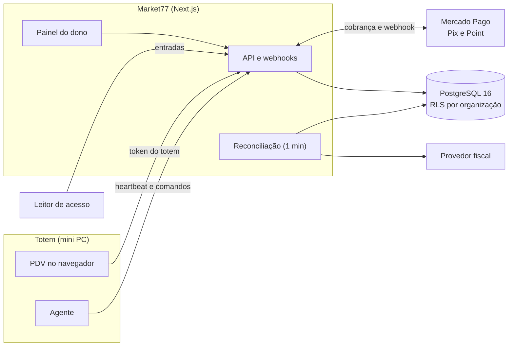

<p align="center">
  <picture>
    <source media="(prefers-color-scheme: dark)" srcset="docs/assets/logo-dark-bg.png">
    <source media="(prefers-color-scheme: light)" srcset="docs/assets/logo-light-bg.png">
    
  </picture>
</p>

<h3 align="center">Plataforma SaaS para mercados autônomos</h3>

<p align="center">
  Catálogo, estoque, totem de autoatendimento, Pix, cartão, nota fiscal e controle de acesso,<br>
  em uma única base multi-tenant.
</p>

<p align="center">
  
  
  
  
  
</p>

---

## Sumário

- [Visão geral](#visão-geral)
- [Funcionalidades](#funcionalidades)
- [Arquitetura](#arquitetura)
- [Início rápido](#início-rápido)
- [Configuração](#configuração)
- [Guias por funcionalidade](#guias-por-funcionalidade)
- [Operação e produção](#operação-e-produção)
- [Segurança e privacidade](#segurança-e-privacidade)
- [Testes](#testes)
- [Estrutura do repositório](#estrutura-do-repositório)
- [Roadmap](#roadmap)

## Visão geral

O Market77 permite operar mercados sem atendente, como os de condomínios. O cliente escaneia os produtos no totem, paga com Pix ou cartão e a venda baixa o estoque sozinha. O dono acompanha tudo por um painel web: vendas, estoque, validade, notas fiscais, totens e acessos.

Cada **organização** (dono) tem os próprios mercados, produtos, totens e credenciais de pagamento, isolados por Row Level Security no Postgres.

## Funcionalidades

| Área | O que entrega |
|---|---|
| **Catálogo e estoque** | Produtos com vários códigos de barras, preço por mercado, estoque por livro-razão (cada movimento fica registrado) |
| **Lote e validade** | Controle de validade por produto, baixa FEFO (vence primeiro, sai primeiro), alertas de vencimento, bloqueio de produto vencido no totem |
| **PDV do totem** | Leitura por código de barras (o leitor funciona como teclado), carrinho, pagamento e confirmação em tempo real |
| **Pagamentos** | Pix e cartão. Mercado Pago (Pix e maquininha Point) com credenciais por organização; simuladores para desenvolvimento |
| **NFC-e** | Emissão em segundo plano a cada venda paga, com fila, novas tentativas e reemissão (provedor simulado) |
| **Agente do totem** | Serviço no mini PC do totem: abre o PDV em tela cheia, envia heartbeat e executa comandos remotos (reiniciar, reboot, atualizar) |
| **Controle de acesso** | Registro de entradas vindas de um leitor, sem guardar imagem nem template facial; esquecimento de pessoa e retenção de 90 dias |
| **Painel do dono** | Mercados, produtos, equipe, totens, vendas, validade, pagamentos e acessos, com permissões por papel (dono, gerente, repositor) |

## Arquitetura



Decisões de projeto:

- **Multi-tenant no banco.** Toda consulta de aplicação roda em `withOrg(orgId, ...)`, que fixa `app.org_id` na transação; as políticas de RLS fazem o resto. O papel de administração só é usado onde ainda não há organização (login, webhooks, filas).
- **Provedores atrás de contratos.** Pix (`PaymentProvider`), cartão (`CardProvider`), nota fiscal (`FiscalProvider`) e acesso (`AccessProvider`) têm simulador e adaptador real intercambiáveis, validados pela mesma suíte de contrato.
- **Webhook avisa, API confirma.** O estado e o valor de um pagamento vêm sempre de uma consulta ao provedor; o corpo do webhook nunca é confiado.
- **Sem fila externa.** Reconciliação preguiçosa e uma única chamada por minuto (`POST /api/internal/reconcile`) cobrem pagamentos pendentes, notas fiscais e sincronização de pessoas.
- **O servidor nunca conecta no totem.** O agente é quem pergunta.

**Stack:** Next.js 15 (App Router, server actions), React 19, TypeScript, Postgres 16 com `postgres.js` e migrations em SQL puro, `zod` e Vitest.

## Início rápido

Requisitos: Node.js 20.6 ou superior (o agente do totem usa 22.18+), Docker.

```bash
docker compose up -d        # Postgres 16 local
cp .env.example .env
npm install
npm run db:migrate
npm run dev                 # http://localhost:3000
```

Crie uma conta em `/signup`, cadastre um mercado, produtos e um totem. Em desenvolvimento, Pix, cartão, nota fiscal e leitor de acesso são simulados (veja os guias abaixo).

## Configuração

Variáveis de ambiente (modelo em `.env.example`):

| Variável | Para que serve |
|---|---|
| `DATABASE_URL` | Conexão de administração (migrations, login, webhooks, filas) |
| `DATABASE_APP_URL` | Conexão do papel `market77_app`, sujeito ao RLS |
| `CREDENTIALS_KEY` | Chave de 32 bytes em base64 (`openssl rand -base64 32`) que cifra, no banco, as credenciais Mercado Pago de cada dono |
| `RECONCILE_SECRET` | Autentica `POST /api/internal/reconcile` |
| `RELEASE_SECRET` | Autoriza a publicação de pacotes do agente |
| `FAKE_PIX_SECRET`, `FAKE_CARD_SECRET` | Assinatura dos webhooks dos simuladores (só desenvolvimento) |
| `FISCAL_PROVIDER`, `ACCESS_PROVIDER` | Provedor fiscal e de acesso (`fake` em desenvolvimento) |

## Guias por funcionalidade

<details>
<summary><strong>Mercado Pago: Pix e cartão (Point)</strong></summary>

Cada organização usa a própria conta. O dono abre **Pagamentos** no painel e cola o access token e o segredo do webhook de uma aplicação criada em "Suas integrações" do Mercado Pago. Sem credenciais, a organização usa o simulador, que recusa funcionar em produção.

- **Pix:** `POST /v1/payments`. **Cartão:** Orders API da Point (`POST /v1/orders`, `type: "point"`). A maquininha de cada totem é o campo **ID da maquininha Point** em **Totens**.
- **Webhook:** uma URL por organização, `POST /api/webhooks/mercadopago/<orgId>` (a tela mostra a URL pronta), com os tópicos Pagamentos (Pix) e Orders (Mercado Pago, cartão) ativados. O tipo da notificação verificada decide se é Pix ou cartão. As rotas `/api/webhooks/pix/mercadopago/<orgId>` e `/api/webhooks/card/mercadopago/<orgId>` seguem como apelidos.
- **Assinatura:** `x-signature` validada com o segredo da organização (HMAC-SHA256, janela de 5 minutos). O estado do pagamento é sempre consultado na API.
- **Atenção:** perder a `CREDENTIALS_KEY` torna as credenciais salvas ilegíveis; o dono precisa colar de novo.

**Roteiro manual (conta de teste e uma Point)**

1. Com `CREDENTIALS_KEY` definida e o servidor no ar, entre como dono, abra **Pagamentos**, cole token e segredo e clique em **Testar**.
2. Cadastre a URL de webhook no painel do Mercado Pago, ative os tópicos Pagamentos e Orders e use o segredo gerado.
3. Em **Totens**, preencha o ID da Point do totem.
4. No totem, pague com Pix: a venda fica paga e o estoque baixa uma vez.
5. Pague com cartão: aprove, recuse, cancele pelo botão do totem e deixe expirar. Confira cada desfecho no totem e em **Vendas**.
6. Confira nos logs que nenhum token, segredo ou corpo de resposta do Mercado Pago aparece.
7. Na primeira execução real, confirme que o manifesto da assinatura (`id`, `request-id`, `ts`) valida nos dois tipos de notificação. Se uma delas voltar 401 com o segredo certo, compare o manifesto com a documentação atual e ajuste `verifyNotification`.

</details>

<details>
<summary><strong>Totem e Pix (simulado em desenvolvimento)</strong></summary>

1. No painel, em **Totens**, cadastre um totem para o mercado e copie o token (ele aparece uma vez).
2. No navegador do totem, abra `/pdv` e cole o token. Cadastre antes produtos com código de barras e coloque-os à venda no mercado.
3. Escaneie os produtos e toque em **Pagar com Pix**.
4. Para "pagar" a cobrança simulada, use o identificador depois de `FAKEPIX|` no código copia e cola:

```bash
curl -X POST http://localhost:3000/api/dev/fake-pix/<identificador>/pay
```

O adaptador `fake` e a rota de pagamento simulado recusam funcionar com `NODE_ENV=production`.

</details>

<details>
<summary><strong>Cartão (simulado em desenvolvimento)</strong></summary>

O totem tem os botões **Pagar com Pix** e **Pagar com cartão**. No cartão a tela pede para seguir as instruções na maquininha (2 minutos), com o botão **Cancelar**. Aprovação paga a venda e baixa o estoque como no Pix; recusa, cancelamento e tempo esgotado devolvem o carrinho com o motivo.

Sem Mercado Pago conectado, o cartão é simulado. Para "passar o cartão" de uma cobrança:

```bash
# identificador: select external_id from payments order by created_at desc limit 1
curl -X POST http://localhost:3000/api/dev/fake-card/<identificador>/approve
curl -X POST http://localhost:3000/api/dev/fake-card/<identificador>/decline
```

Um adaptador real implementa `CardProvider` (`src/payments/card.ts`). O simulador e as rotas `/api/dev/fake-card` recusam funcionar com `NODE_ENV=production`.

</details>

<details>
<summary><strong>Lote e validade</strong></summary>

Em **Mercados**, ao adicionar ou atualizar um produto, marque **Controla validade** para os perecíveis. Para esses produtos:

- Toda **entrada** exige a data de validade. Entradas na mesma data somam no mesmo lote.
- A **venda** baixa sempre o lote que vence primeiro (FEFO). Perda e ajuste negativo fazem o mesmo, ou baixam um lote escolhido.
- A seção **Validade** do mercado lista os lotes vencidos e os que vencem em 7 dias; a página inicial mostra quantos já venceram.
- O totem recusa ("Produto vencido. Procure o atendimento.") um produto cujo saldo inteiro está em lotes vencidos.

O saldo anterior à ativação do controle continua valendo como "saldo sem lote" e sai por último.

</details>

<details>
<summary><strong>NFC-e</strong></summary>

Cada venda paga de um mercado com **Emitir NFC-e** ligada gera uma nota fiscal, emitida em segundo plano. A venda continua paga mesmo se a nota falhar.

1. Em **Mercados**, preencha **Dados fiscais (NFC-e)**: CNPJ, inscrição estadual, UF e série. Só o Simples Nacional emite; o regime normal fica registrado, mas a nota vai para erro.
2. Em **Produtos**, abra **Dados fiscais** e informe o NCM (8 dígitos). CFOP, CSOSN, unidade e origem vêm com padrões do Simples (5102, 102, UN, 0).
3. No totem, o cliente pode tocar em **CPF na nota** antes de pagar. Sem CPF, a nota sai como consumidor não identificado.
4. A fila roda na chamada de cada minuto de `POST /api/internal/reconcile`. Provedor fora do ar: nova tentativa em 1, 2, 4... até 60 minutos, 8 vezes; depois a nota fica **Com erro**. Dados inválidos ficam **Com erro** na hora.
5. Em **Vendas**, o detalhe mostra número, chave, DANFE e a última falha, com o botão **Reemitir**.

Em desenvolvimento a nota é simulada (`FISCAL_PROVIDER=fake`). Para testar falhas:

```bash
curl -X POST http://localhost:3000/api/dev/fake-fiscal/mode -d '{"mode":"down"}'   # ok | down | reject | lost
```

Ainda não há provedor fiscal real: não ligue **Emitir NFC-e** em produção, porque com o simulador cada nota fica indisponível por cerca de 2 horas e vira erro. Um provedor real implementa `FiscalProvider` (`src/fiscal/provider.ts`).

</details>

<details>
<summary><strong>Controle de acesso</strong></summary>

O dono vê quem entra no mercado e quando. Um leitor (por exemplo, facial) manda cada entrada para o Market77, que **nunca guarda imagem nem template facial**: só o identificador da pessoa e a hora. O nome vem de um cadastro sincronizado com o leitor.

1. Em **Mercados**, abra o mercado e entre em **Acessos** (só o dono). Cadastre um **leitor** e copie o token (aparece uma única vez).
2. O leitor envia cada entrada com o token:

```bash
curl -X POST http://localhost:3000/api/access/events \
  -H "Authorization: Bearer <token>" -H "Content-Type: application/json" \
  -d '{"occurredAt":"2026-10-05T14:30:00-03:00","eventId":"abc123","personId":"u-42"}'
```

   `eventId` (opcional) evita duplicar a mesma entrada; `personId` (opcional) é o identificador da pessoa no leitor. A data aceita até 5 minutos de adiantamento e 7 dias de atraso.
3. A lista de pessoas é puxada do leitor a cada 10 minutos pela reconciliação. Quem some da lista fica inativo.
4. A tela mostra o resumo por dia (entradas, pessoas, vendas pagas e vendas por entrada), as entradas por hora, os acessos recentes, as pessoas e os leitores.
5. **Esquecer pessoa** apaga o nome, tira o identificador dos acessos antigos e impede a sincronização de recriar a pessoa.
6. Os acessos ficam 90 dias; a limpeza roda na reconciliação.

Em desenvolvimento a lista de pessoas é simulada (`ACCESS_PROVIDER=fake`):

```bash
curl -X POST http://localhost:3000/api/dev/fake-access/people \
  -d '{"sourceId":"<id do leitor>","people":[{"externalId":"u-42","name":"Ana Souza"}]}'
curl -X POST http://localhost:3000/api/dev/fake-access/mode -d '{"mode":"down"}'   # ok | down
```

Um leitor real implementa `AccessProvider` (`src/access/provider.ts`).

</details>

## Operação e produção

### Agente do totem

O agente roda no mini PC (Ubuntu): abre o PDV em tela cheia, envia um heartbeat a cada 30 s e executa os comandos do painel (**Totens**: Reiniciar PDV, Reboot, Atualizar agente).

```bash
# Publicar uma versão (com RELEASE_SECRET no .env)
npm run agent:release -- 1.0.0 https://seu-servidor

# Instalar em um totem (token copiado do painel)
curl -fsSL -H "Authorization: Bearer <token>" https://seu-servidor/api/agent/releases/1.0.0 -o agent.tgz
mkdir agent && tar -xzf agent.tgz -C agent && cd agent
sudo ./install.sh https://seu-servidor <token>
sudo reboot
```

O instalador coloca Node 22.18+ e o Chromium, cria o usuário `kiosk` (autologin em X11), a regra `sudoers` só para `systemctl reboot`, o serviço `market77-agent` e o `market77-watchdog`, que volta à versão anterior se uma atualização não der heartbeat em 2 minutos. Para atualizar, publique uma versão nova e use **Atualizar agente** no painel: o agente baixa o pacote, confere o SHA-256, troca a versão e reinicia sozinho. O pacote fica no Postgres (limite de 20 MB).

Um totem sem batida há mais de 2 minutos aparece como **offline**. Um comando que fica mais de 10 minutos na fila expira e nunca roda depois.

### Reconciliação (1 chamada por minuto)

Em hospedagens sem cron (Firebase App Hosting, Cloud Run), agende uma chamada por minuto, por exemplo no Cloud Scheduler:

```bash
curl -X POST https://seu-servidor/api/internal/reconcile -H "x-reconcile-secret: $RECONCILE_SECRET"
```

A resposta traz `{ visited, fiscal, access }`: pagamentos pendentes visitados, fila fiscal e sincronização e limpeza de acessos. As três filas rodam isoladas.

### Banco de dados

Troque a senha do papel `market77_app` (`ALTER ROLE market77_app PASSWORD '...'`) e use essa senha em `DATABASE_APP_URL`.

## Segurança e privacidade

- **Isolamento por organização** com Row Level Security; o papel da aplicação não é dono das tabelas.
- **Credenciais de pagamento** cifradas com AES-256-GCM (`CREDENTIALS_KEY`); nunca voltam para a tela, para log ou para mensagem de erro, e o corpo de erro do provedor nunca é copiado.
- **Webhooks** verificados por assinatura (HMAC com `timingSafeEqual`) antes de qualquer consulta; o estado vem da API do provedor.
- **Tokens** de totem, leitor e agente são guardados só como hash SHA-256 e revogáveis; o token em claro aparece uma única vez.
- **Simuladores** recusam funcionar com `NODE_ENV=production`.
- **Dado biométrico (LGPD).** O sistema não guarda imagem nem template facial. A base legal (em geral, consentimento específico dos moradores) e o aviso a eles são responsabilidade de quem opera o condomínio.

## Testes

```bash
docker compose up -d
npm test            # banco market77_test, criado e migrado automaticamente
npm run typecheck
```

A suíte roda sem rede (provedores externos usam `fetch` injetado e respostas gravadas) e cobre domínio, isolamento entre organizações, webhooks, contratos de provedores e o agente. Para rodar worktrees em paralelo, use um banco por worktree: `TEST_DB=market77_test_outro npm test`.

## Estrutura do repositório

```text
src/
  app/        páginas, server actions e rotas de API (painel, PDV, webhooks, agente)
  domain/     regras de negócio (vendas, pagamentos, estoque, lotes, fiscal, acessos)
  payments/   provedores de Pix e cartão: simuladores e Mercado Pago
  fiscal/     contrato e simulador da NFC-e
  access/     contrato e simulador do leitor de acesso
  auth/       sessões, papéis e permissões
  db/         cliente, transação por organização e migrations SQL
  pdv/        handlers HTTP do totem
agent/        agente do mini PC do totem (instalador, heartbeat, watchdog)
scripts/      migrations e publicação do agente
tests/        suíte Vitest, espelhando a estrutura de src/
docs/         especificações e planos de cada fase (docs/superpowers/)
```

## Roadmap

| Fase | Entrega | Estado |
|---|---|---|
| 1 | Base multi-tenant, catálogo e estoque por livro-razão | Concluída |
| 2 | PDV do totem, venda e Pix | Concluída |
| 3 | Agente do totem, heartbeat e comandos remotos | Concluída |
| 4 | Cartão na maquininha | Concluída |
| 5A | Lote e validade | Concluída |
| 5B | NFC-e (provedor simulado) | Concluída |
| 6 | Registro de acessos (leitor simulado) | Concluída |
| 7 | Mercado Pago: Pix e Point, credenciais por organização | Concluída (roteiro manual pendente) |
| Próximas | Provedor fiscal real, regime normal e cancelamento de nota; leitor de acesso real; estorno e parcelamento; OAuth do Mercado Pago; outras maquininhas | Planejadas |

Especificações e planos de cada fase estão em [`docs/superpowers/`](docs/superpowers/).
